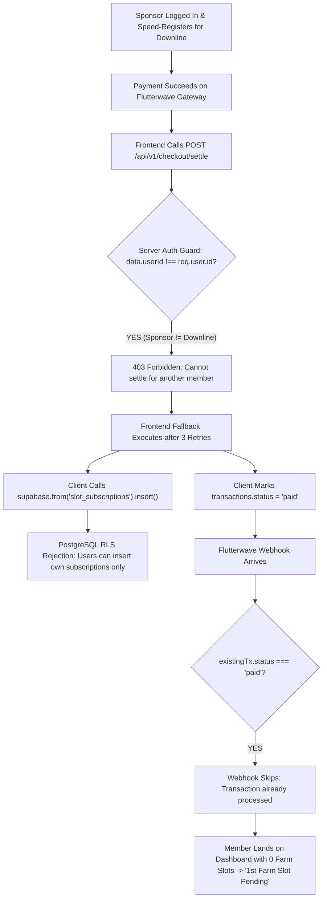

# System Architecture Learnings: Speed Registration, Sponsor Settlement & Webhook Resilience
**Engineering Milestone**: Resolution of Speed-Register / Sponsor Downline Settlement Drop & Unallotted Farm Slots  
**Date Evaluated**: November 6, 2026  
**Auditor / Engineering Context**: AgroHeal Platform Checkout, Universal Webhook Receiver & Automated Allotment Engine  

---

## 1. Executive Summary & Problem Statement

Multiple downline members registered and paid for by their direct sponsors (e.g., Mrs. Edith Nwafor, Nicholas Adakole, Beatrice Omeneki) were left in a state where:
- Their payment of ₦15,000 was confirmed and captured as `status = 'paid'` on `transactions`.
- Their `profiles.has_greencard` flag was set to `true`.
- **CRITICAL FAILURE**: They had **0 active farm slots in `slot_subscriptions`**, **0 order rows in `orders` for Mushroom Power 100g**, **no matrix placement in `matrix_positions`**, and their sponsor had **not received the statutory ₦2,500 referral commission**.
- When logging in, members saw the prominent warning: **"What to do now? 1st Farm Slot Pending — Subscribe to 1st Farm Slot (₦5,000)"**.

This document captures the exact architectural failure chain, root causes, and multi-tier hardened solutions implemented across `agroheal-fe` and `agroheal-server`.

---

## 2. Root Cause Analysis: The 4-Stage Breakdown



### 1. The 403 Forbidden on Sponsor Settlement
- In `agroheal-server/src/modules/checkout/checkout.controller.ts`:
  ```typescript
  // PREVIOUS FRAGILE LOGIC:
  if (data.userId && data.userId !== req.user.id && req.user.role !== "admin") {
    return sendError(res, "Forbidden: cannot settle for another member", 403);
  }
  ```
- In Nigerian affiliate marketing networks, active sponsors frequently register and pay on behalf of non-tech-savvy downlines while remaining signed in to their own accounts.
- `req.user.id` was the **sponsor's UUID**, while `data.userId` was the **downline's UUID**. Because the sponsor was not an admin, every single call to `/api/v1/checkout/settle` was rejected with `403 Forbidden`.

### 2. Client Fallback Blocked by PostgreSQL RLS
- In `apps/web/src/page/website/Slots/Checkout.tsx`:
  When `/api/v1/checkout/settle` failed 3 times, the client executed a local fallback:
  1. It set `transactions.status = 'paid'`.
  2. It called `recordSubscriptionWithFarmGroupSplit` to insert directly into `slot_subscriptions` using the browser's Supabase client.
- PostgreSQL Row-Level Security (`Users can insert own subscriptions`) enforces `auth.uid() = user_id`.
- Because the sponsor was the authenticated user (`auth.uid() = sponsor_id`), PostgreSQL **silently rejected the insert** for the downline's slot subscription.
- The client fallback also lacked the logic to generate an AGC member ID, insert `orders` rows for Mushroom Power 100g, credit statutory commissions, or seat the member in the 5×7 matrix.

### 3. Webhook Premature Skip
- In `agroheal-server/src/modules/webhooks/webhooks.controller.ts`:
  ```typescript
  // PREVIOUS FRAGILE LOGIC:
  if (existingTx && existingTx.status === "paid") {
    console.log(`[Webhook:${provider.toUpperCase()}] Transaction ${txRef} already marked paid. Skipping.`);
    return res.status(200).json({ status: "success", message: "Transaction already processed" });
  }
  ```
- Because the client fallback had already written `status = 'paid'` to disk, when the Flutterwave webhook arrived seconds later, it assumed fulfillment had completed and **exited without allocating slots, orders, or commissions**.

### 4. Gateway Reference Mismatch in Guest Checkouts (`/pay` & `/gc`)
- In `apps/web/src/hooks/usePaymentGateway.ts`:
  The Flutterwave inline callback prioritized `response.transaction_id` (a numeric string like `"2115176412"`) over `response.tx_ref` (`GC_GUEST_...` or `COMBO_...`).
- When `GuestPaymentDrawer` called `/api/v1/checkout/claim-account` with `txRef: "2115176412"`, the database only contained `transaction_ref = "GC_GUEST_..."` and `payment_reference = null`.
- `claim-account` failed with `404 Not Found: Transaction not found for the provided reference`, stranding the guest on a fallback claim form.

---

## 3. The Multi-Tier Hardened Solution

### Layer 1: Sponsor Authorization Guard (`checkout.controller.ts`)
Instead of restricting cross-member settlement solely to admins, the endpoint now explicitly verifies sponsor attribution:
```typescript
let isAuthorized = !data.userId || data.userId === req.user.id || req.user.role === "admin";
if (!isAuthorized && data.userId) {
  const { data: targetProf } = await supabaseAdmin
    .from("profiles")
    .select("sponsor_id, referred_by")
    .eq("id", data.userId)
    .maybeSingle();

  const sponsorId = targetProf?.sponsor_id || targetProf?.referred_by;
  if (sponsorId && sponsorId === req.user.id) {
    isAuthorized = true; // Authorized direct sponsor speed-registration
  } else if (data.transactionId) {
    const { data: txRow } = await supabaseAdmin
      .from("transactions")
      .select("user_id, notes")
      .eq("id", data.transactionId)
      .maybeSingle();

    if (txRow && (txRow.user_id === req.user.id || txRow.user_id === data.userId)) {
      isAuthorized = true;
    }
  }
}
```

### Layer 2: Webhook Self-Healing Audit (`webhooks.controller.ts`)
When a webhook arrives for an already-paid transaction, it now audits whether the member actually received their slot subscription:
```typescript
if (existingTx && existingTx.status === "paid") {
  const txAmount = Number(existingTx.amount || 0);
  const isComboOrSlot = txAmount >= 5000 || (existingTx.project_category || "").toLowerCase().includes("combo");
  if (isComboOrSlot && existingTx.user_id) {
    const { data: existingSlot } = await supabaseAdmin
      .from("slot_subscriptions")
      .select("id")
      .or(`checkout_id.eq.${existingTx.id},transaction_id.eq.${existingTx.id}`)
      .maybeSingle();

    if (!existingSlot) {
      console.warn(`[Webhook] Paid tx ${txRef} lacks active slot allotment. Executing recovery force settle...`);
      await executeForceSettleTransaction(
        existingTx.id,
        "WEBHOOK_AUTO_RECOVERY",
        `Self-healed missing allotments on ${provider.toUpperCase()} webhook delivery`
      );
    }
  }
  return res.status(200).json({ status: "success", message: "Transaction already processed" });
}
```

### Layer 3: Dashboard Entry Real-Time Auto-Repair (`verifyPendingCheckoutHandler`)
Every time ANY member opens their dashboard, `Dashboard.tsx` invokes `apiClient.checkout.verifyPending()`.
This endpoint now checks for both:
1. Pending transactions within the last 48 hours (requeries payment gateways).
2. **Paid transactions missing slot allotments** (`amount >= 5000` with 0 rows in `slot_subscriptions`).
If an unallotted paid transaction is detected, it auto-repairs in real time before the dashboard finishes loading, ensuring the member immediately sees their active slot and never encounters "1st Farm Slot Pending".

### Layer 4: Reference Synchronization & Gateway Reverse Lookup
1. **Frontend (`usePaymentGateway.ts`)**: The callback now explicitly prioritizes `response.tx_ref || txRef` so `reference` always matches the database's `transaction_ref`.
2. **Backend (`claimAccountHandler` & `getClaimStatusHandler`)**: If a lookup by reference fails, the server automatically queries Flutterwave to resolve the gateway ID to its original `data.tx_ref`, links the payment reference, and fulfills the claim seamlessly.

---

## 4. Architectural Rules & Invariants for Pair Programming

1. **Never Rely on Client-Side Database Inserts for Financial Allotments**:
   - All state mutations involving slots, product orders, AGC member IDs, and ledger distributions MUST execute via server endpoints running with `service_role` (bypassing user RLS).
2. **Never Treat `status === 'paid'` on `transactions` as Proof of Fulfillment**:
   - Always verify concrete fulfillment records (`slot_subscriptions`, `orders`, `profiles.member_id`) before skipping processing in webhooks and background sweeps.
3. **Sponsors Have Agency to Pay for Downlines**:
   - Authorization rules must allow authenticated sponsors to initiate, verify, and settle transactions for their direct downlines.
4. **Idempotency Must Repair Rather Than Block**:
   - If an account claim or settlement request arrives for an existing transaction where `user_id` matches, the system must complete missing steps rather than throwing a blanket 400 error.
